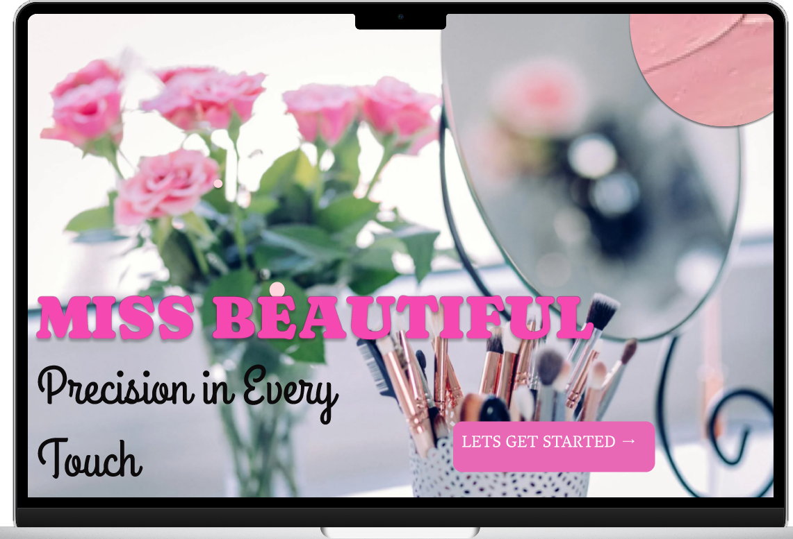
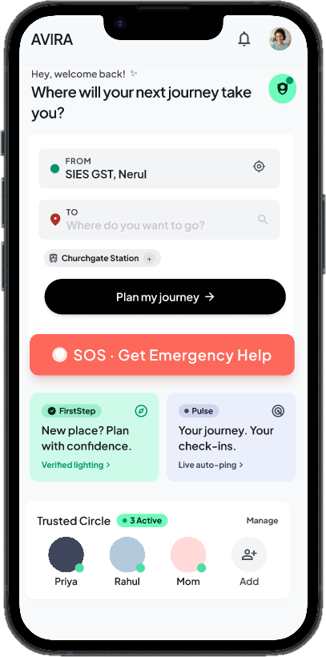
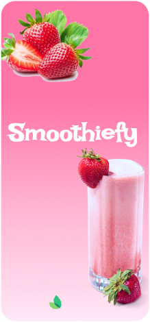
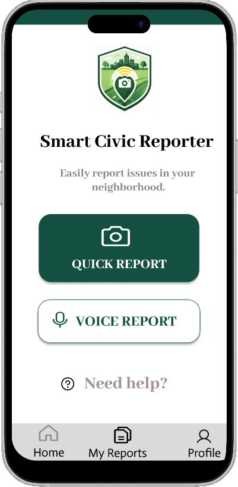
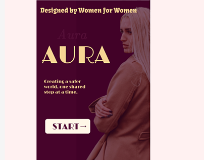

<div align="center">

  <!-- 3D Glow Header -->
  <a href="https://vaishnvikedar6-jpg.github.io/design-portfolio-website/">
    
  </a>

  <p align="center">
    <b><i>"I design how it feels."</i></b>
  </p>

  <p align="center">
    Thoughtful digital experiences shaped by creativity, human-centered empathy, and cutting-edge web technology.
  </p>

  <!-- 3D Style Pill Badges -->
  <p align="center">
    <a href="https://vaishnvikedar6-jpg.github.io/design-portfolio-website/">
      
    </a>
    <a href="https://github.com/vaishnvikedar6-jpg/design-portfolio-website/actions">
      
    </a>
    <a href="https://github.com/vaishnvikedar6-jpg">
      
    </a>
  </p>

</div>

---

### 🌸 About the Portfolio

A handcrafted, high-performance portfolio featuring:
* ✨ **Bespoke Aesthetics:** Warm blush & berry palette inspired by modern editorial minimalism.
* 🎭 **3D Motion & Interactions:** Interactive tilt cards, fluid viewport reveal animations, and floating botanical physics.
* 📱 **Triple-Stage App Mockups:** Custom multi-screen phone perspective showcases (AVIRA, Smoothiefy, Miss Beautiful).
* ⚡ **Next-Gen Web Performance:** Powered by Vite & React 19 with 100/100 Lighthouse-optimized asset delivery.

<br/>

<div align="center">

```
 ╭────────────────────────────────────────────────────────────────────────────╮
 │  ✦ LIVE SITE : https://vaishnvikedar6-jpg.github.io/design-portfolio-website/  │
 ╰────────────────────────────────────────────────────────────────────────────╯
```

</div>

---

### 🎨 Featured Design Case Studies

<table align="center" width="100%">
  <tr>
    <td width="33%" align="center" valign="top">
      
      <br/><br/>
      <b>💄 Miss Beautiful</b>
      <br/>
      <sub>Luxury Cosmetic UX & E-Commerce Flow</sub>
      <br/><br/>
      
    </td>
    <td width="33%" align="center" valign="top">
      
      <br/><br/>
      <b>🌱 AVIRA</b>
      <br/>
      <sub>AI-Powered Wellness & Daily Companion</sub>
      <br/><br/>
      
    </td>
    <td width="33%" align="center" valign="top">
      
      <br/><br/>
      <b>🍓 Smoothiefy</b>
      <br/>
      <sub>Artisanal Smoothie Ordering App Concept</sub>
      <br/><br/>
      
    </td>
  </tr>
  <tr>
    <td width="33%" align="center" valign="top">
      
      <br/><br/>
      <b>🏛️ CivicFix</b>
      <br/>
      <sub>Smart Community Issue Reporting Platform</sub>
      <br/><br/>
      
    </td>
    <td width="33%" align="center" valign="top">
      
      <br/><br/>
      <b>✨ Aura & Atelier</b>
      <br/>
      <sub>Couture Fashion & Lifestyle Lookbook</sub>
      <br/><br/>
      
    </td>
    <td width="33%" align="center" valign="middle">
      
      <br/><br/>
      <b>🌷 Vaishnavi Kedar</b>
      <br/>
      <sub>Available for Remote Internships</sub>
      <br/><br/>
      
    </td>
  </tr>
</table>

---

### 🛠️ Tech Stack & Creative Suite

<div align="center">

| Domain | Technologies & Tools |
| :--- | :--- |
| **Product & UI/UX Design** |    |
| **Frontend Engineering** |    |
| **Tooling & Workflows** |    |

</div>

---

### 💻 Local Development Setup

```bash
# 1. Clone the repository
git clone https://github.com/vaishnvikedar6-jpg/design-portfolio-website.git
cd design-portfolio-website

# 2. Install workspace dependencies
pnpm install

# 3. Start development server with live reload
pnpm --filter @workspace/vaishnavi-portfolio run dev

# 4. Build optimized production bundle
pnpm --filter @workspace/vaishnavi-portfolio run build
```

---

<div align="center">

  ### 📬 Connect & Collaborate

  <a href="https://github.com/vaishnvikedar6-jpg">
    
  </a>
  <a href="https://vaishnvikedar6-jpg.github.io/design-portfolio-website/">
    
  </a>

  <br/><br/>
  
  

  <sub>Crafted with passion, thoughtful design, and clean code by <b>Vaishnavi Kedar</b> © 2026</sub>

</div>
